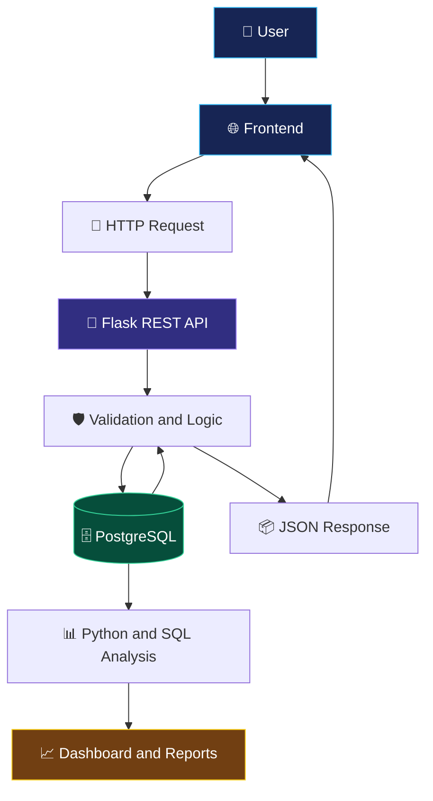

<!--
  KANISHKA | NEON ANIME DEVELOPER PORTFOLIO
  Replace YOUR_USERNAME, YOUR_EMAIL, and social links.
-->

<div align="center">


<!-- Optional custom anime banner: upload your image to assets/anime-banner.png -->
<!--  -->


<br/>


<br/><br/>

<a href="https://github.com/YOUR_USERNAME">

</a>
<a href="https://www.linkedin.com/in/YOUR_LINKEDIN_USERNAME/">

</a>
<a href="mailto:YOUR_EMAIL">

</a>

</div>

---

<div align="center">

# 🌌 ABOUT ME

### ✨ Turning Curiosity Into Code and Data Into Insights

</div>

Hello! I'm **Kanishka**, an aspiring technology professional interested in **Python development, data analytics, database management, and business intelligence**.

I enjoy understanding how applications work, how data moves between systems, how databases store information, and how analytical insights can support better decisions.

My goal is to strengthen my technical skills by building practical projects, solving problems, learning from errors, and documenting what I create.

- 🐍 Exploring Python programming and object-oriented programming.
- 📊 Learning to analyse data and understand business performance.
- 🗄️ Practising SQL queries and PostgreSQL database operations.
- 🔌 Building familiarity with Flask and REST API development.
- 🌐 Connecting frontend interfaces with backend services.
- 📈 Exploring KPI reporting, dashboards, and data visualization.
- 🧩 Improving problem-solving and debugging skills.
- 🚀 Building projects to demonstrate practical knowledge.

> 💡 My philosophy: Learn the concept, build the solution, test the result, and improve it.

---

# 🎯 MY CAREER FOCUS

<table>
<tr>
<td width="50%" valign="top">

### 📊 Data Analytics

Understand datasets, investigate patterns, calculate metrics, and communicate findings.

**Areas of interest**
- Data cleaning and transformation
- Exploratory data analysis
- SQL reporting
- KPI calculations
- Data visualization
- Business insights

</td>
<td width="50%" valign="top">

### 🐍 Python Development

Build readable, reusable programs and develop practical backend applications.

**Areas of interest**
- Python fundamentals
- Object-oriented programming
- Flask applications
- REST APIs
- Error handling
- Automation

</td>
</tr>
<tr>
<td width="50%" valign="top">

### 🗄️ Database Management

Organize structured information and build reliable database-driven applications.

**Areas of interest**
- SQL queries
- PostgreSQL
- CRUD operations
- Database relationships
- Data validation
- Relational data modeling

</td>
<td width="50%" valign="top">

### 📈 Business Intelligence

Translate business data into clear reports that support decision-making.

**Areas of interest**
- Power BI dashboards
- Business KPIs
- Trend analysis
- Category comparisons
- Performance reporting
- Visual storytelling

</td>
</tr>
</table>

---

# 🛠️ TECHNICAL SKILLS

<div align="center">

### 💻 My Technology Stack

</div>

<table>
<tr>
<td width="50%" valign="top">

### 🐍 Programming Languages

<p>

</p>

<p>

</p>

<p>

</p>

### 🌐 Frontend

<p>


</p>

</td>
<td width="50%" valign="top">

### 🔌 Backend and APIs

<p>


</p>

### 🗄️ Databases

<p>


</p>

### 📊 Analytics

<p>


</p>

</td>
</tr>
<tr>
<td width="50%" valign="top">

### ⚙️ Tools and Platforms

<p>


</p>

<p>


</p>

</td>
<td width="50%" valign="top">

### 🧠 Core Technical Concepts

- Object-oriented programming
- HTTP methods and status codes
- JSON request and response handling
- REST API design
- Database CRUD operations
- Relational database concepts
- Data validation and error handling
- Data cleaning and aggregation
- Frontend/backend integration
- Debugging and problem-solving

</td>
</tr>
</table>

## 📊 Visual Skill Dashboard

The bars below are **illustrative self-assessments**. Change the percentages to match your actual proficiency and remove any technology you have not used.

<table>
<tr>
<td width="50%" valign="top">

### 🐍 Programming

**Python — 60%**


**SQL — 55%**


**JavaScript — 35%**


</td>
<td width="50%" valign="top">

### 🔌 Backend

**Flask and REST APIs — 50%**


**PostgreSQL — 50%**


**HTML and CSS — 45%**


</td>
</tr>
<tr>
<td width="50%" valign="top">

### 📈 Analytics

**Power BI — 40%**


**Pandas and NumPy — 35%**


</td>
<td width="50%" valign="top">

### ⚙️ Development Tools

**Git and GitHub — 50%**


**Docker and Airflow — 25%**


</td>
</tr>
</table>

---

# 🚀 FEATURED PROJECTS

<div align="center">

### 🧩 Building Practical Solutions

</div>

<table>
<tr>
<td width="50%" valign="top">

### 🔎 AI Business Detective


**Objective:** Analyse business performance and present useful insights through reports and dashboards.

**Planned features**
- Revenue and sales analysis
- Product performance
- Customer segmentation
- KPI monitoring
- Trend analysis
- Interactive visualizations
- AI-assisted explanations as a future enhancement

**Technology:** Python, SQL, Power BI.

[View repository](https://github.com/YOUR_USERNAME/ai-business-detective)

</td>
<td width="50%" valign="top">

### 👥 Customer Management API


**Objective:** Build an API to manage customer records using a database.

**Core features**
- Create customer records
- Retrieve records
- Update customer details
- Delete records
- Validate requests
- Return JSON responses
- Handle invalid inputs and missing records

**Technology:** Python, Flask, PostgreSQL, SQL.

[View repository](https://github.com/YOUR_USERNAME/customer-management-api)

</td>
</tr>
<tr>
<td width="50%" valign="top">

### 🌐 Frontend + Backend Integration


**Objective:** Connect a web interface to backend API endpoints.

**Core features**
- Dynamic data tables
- Form submissions
- Create, edit, and delete operations
- API response handling
- Validation messages
- Error feedback
- Responsive layouts

**Technology:** HTML, CSS, JavaScript, Flask.

[View repository](https://github.com/YOUR_USERNAME/frontend-backend-integration)

</td>
<td width="50%" valign="top">

### 📊 Business Data Analysis


**Objective:** Explore business datasets and communicate findings.

**Potential analysis**
- Monthly revenue
- Sales by category
- Customer behaviour
- KPI comparisons
- Growth calculations
- Data quality checks
- Business reporting

**Technology:** Python, SQL, Pandas, Power BI.

[View repository](https://github.com/YOUR_USERNAME/business-data-analysis)

</td>
</tr>
</table>

> These are project descriptions and suggested repository names. Update each card to match the features you have actually implemented.

---

# 🏗️ HOW MY APPLICATIONS WORK



### 🔄 Development Workflow

| Stage | Activity |
|---|---|
| 01 — Understand | Define the problem and requirements |
| 02 — Design | Plan the data model and application structure |
| 03 — Develop | Implement application logic and endpoints |
| 04 — Integrate | Connect the frontend, API, and database |
| 05 — Test | Check normal and invalid inputs |
| 06 — Analyse | Validate results and calculate metrics |
| 07 — Document | Explain setup, usage, and limitations |
| 08 — Improve | Refine the solution using feedback |

---

# 📚 MY LEARNING ROADMAP

### 🐍 Python and Software Development
- [ ] Strengthen Python fundamentals
- [ ] Practise functions, modules, and OOP
- [ ] Improve debugging and exception handling
- [ ] Learn automated testing
- [ ] Build reusable applications

### 🗄️ SQL and Databases
- [ ] Practise joins and subqueries
- [ ] Learn common table expressions
- [ ] Improve database modeling
- [ ] Understand transactions and indexes
- [ ] Practise analytical SQL queries

### 🔌 Backend Development
- [ ] Build structured Flask applications
- [ ] Improve REST API design
- [ ] Add validation and error handling
- [ ] Test endpoints systematically
- [ ] Explore authentication and deployment

### 📊 Data Analytics
- [ ] Practise data cleaning with Pandas
- [ ] Strengthen exploratory data analysis
- [ ] Build SQL reporting queries
- [ ] Create Power BI dashboards
- [ ] Improve KPI design and storytelling

### ⚙️ Tools and Engineering
- [ ] Improve Git branching and collaboration
- [ ] Learn Docker fundamentals
- [ ] Explore workflow orchestration
- [ ] Improve project documentation
- [ ] Practise deployment workflows

---

# 📊 GITHUB ANALYTICS

<div align="center">

<a href="https://github.com/YOUR_USERNAME">

</a>
<a href="https://github.com/YOUR_USERNAME">

</a>

<br/><br/>


<br/><br/>


</div>

> Analytics cards use external services. They may be temporarily unavailable, and repository language statistics do not measure personal proficiency.

---

# 🐍 CONTRIBUTION SNAKE

<div align="center">


</div>

### ⚡ Enable the Animation

Create `.github/workflows/snake.yml` in your profile repository:

```yaml
name: Generate Contribution Snake

on:
  schedule:
    - cron: "0 0 * * *"
  workflow_dispatch:

permissions:
  contents: write

jobs:
  generate:
    runs-on: ubuntu-latest
    steps:
      - name: Generate snake
        uses: Platane/snk/svg-only@v3
        with:
          github_user_name: YOUR_USERNAME
          outputs: dist/github-contribution-snake.svg

      - name: Publish snake
        uses: peaceiris/actions-gh-pages@v4
        with:
          publish_branch: output
          publish_dir: dist
          github_token: ${{ secrets.GITHUB_TOKEN }}
```

**Setup steps**
1. Replace `YOUR_USERNAME` with your GitHub username.
2. Commit and push the workflow file.
3. Open the repository's **Actions** tab.
4. Run **Generate Contribution Snake** manually.
5. Confirm that the workflow succeeds and creates the `output` branch.
6. Refresh your profile after the SVG has been published.

---

# 🏅 CERTIFICATIONS AND ACHIEVEMENTS

<details>
<summary>🎓 Certifications</summary>

Add only certifications you have actually earned.

- **Certification:** YOUR_CERTIFICATION
- **Issuer:** YOUR_ISSUER
- **Date:** YOUR_COMPLETION_DATE
- **Credential URL:** YOUR_CREDENTIAL_URL

</details>

<details>
<summary>📘 Courses and Training</summary>

- **Course:** YOUR_COMPLETED_COURSE
- **Platform:** YOUR_LEARNING_PLATFORM
- **Skills learned:** YOUR_LEARNED_SKILLS

</details>

<details>
<summary>🏆 Project Achievements</summary>

Add measurable achievements when you have evidence for them.

Examples:
- Completed a working REST API with database integration.
- Created a dashboard with validated KPI calculations.
- Added tests for application endpoints.
- Published a reproducible data analysis.
- Documented installation and execution steps.

</details>

---

# 🧠 MY DEVELOPER MINDSET

<div align="center">

| Principle | What it means |
|---|---|
| 🔍 Understand | Define the real problem |
| 📊 Analyse | Use evidence and accurate data |
| 🛠️ Build | Develop practical solutions |
| 🧪 Test | Verify expected and unexpected cases |
| 📝 Document | Make work easier to understand |
| 🚀 Improve | Learn from feedback and mistakes |

<br/>

### 🌱 Small Steps. Consistent Progress. Better Solutions.

</div>

---

# 🌠 ANIME-INSPIRED MOTIVATION

<div align="center">


### ⚔️ Every Challenge Is Another Level to Conquer

*Keep learning. Keep building. Never stop improving.*

</div>

---

# 🤝 LET'S CONNECT

<div align="center">

Have a project idea, a technical question, or an opportunity to collaborate? Feel free to connect.

<a href="https://github.com/YOUR_USERNAME">

</a>
<a href="https://www.linkedin.com/in/YOUR_LINKEDIN_USERNAME/">

</a>
<a href="mailto:YOUR_EMAIL">

</a>

<br/><br/>

### 💜 DREAM BIG. CODE SMART. GROW EVERY DAY.


</div>
