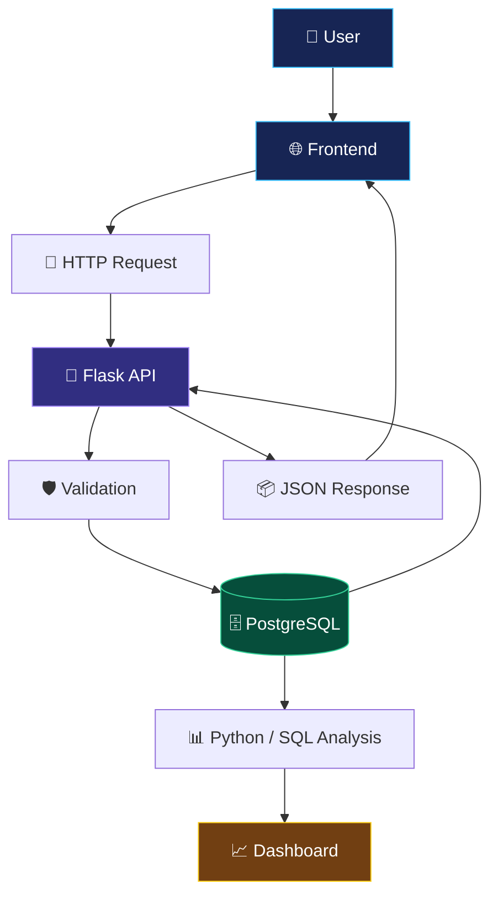

<div align="center">


<br/>


<br/><br/>

<a href="https://github.com/YOUR_USERNAME">

</a>
<a href="https://www.linkedin.com/">

</a>

</div>

---

## 🌌 About Me


Hi, I'm **Kanishka** 👋

I'm interested in **data analytics, Python development, backend development, and business intelligence**. I enjoy building practical applications, working with databases, analysing data, and learning technologies that solve real-world problems.

- 🐍 Python programming and OOP
- 📊 Data analysis and visualization
- 🗄️ SQL and PostgreSQL
- 🔌 Flask and REST APIs
- 🌐 Frontend and backend integration
- 📈 Business intelligence and KPIs
- ⚙️ Git, GitHub, Docker, and workflow tools
- 🚀 Continuous learning and project development

<br clear="right"/>

> 💡 My mindset: Learn something new, build something useful, and improve every day.

---

## 🎯 Areas of Interest

<table>
<tr>
<td width="50%" valign="top">

### 📊 Data Analytics

- Data cleaning and transformation
- Exploratory data analysis
- SQL reporting
- KPI calculations
- Trend analysis
- Data visualization
- Business insights

</td>
<td width="50%" valign="top">

### 🐍 Python Development

- Python fundamentals
- Functions and modules
- Object-oriented programming
- Flask applications
- REST API development
- Error handling
- Debugging

</td>
</tr>
<tr>
<td width="50%" valign="top">

### 🗄️ Database Management

- SQL queries
- PostgreSQL
- CRUD operations
- Joins and subqueries
- Relational databases
- Data validation

</td>
<td width="50%" valign="top">

### 📈 Business Intelligence

- Power BI dashboards
- Business performance reporting
- KPI monitoring
- Sales and revenue analysis
- Data storytelling
- Decision-support reporting

</td>
</tr>
</table>

---

## 🛠️ Technical Skills

### 💻 Programming Languages

<p>


</p>

### 🌐 Frontend Development

<p>


</p>

### 🔌 Backend and APIs

<p>


</p>

### 🗄️ Databases

<p>


</p>

### 📊 Data Analysis and Visualization

<p>


</p>

### ⚙️ Developer Tools

<p>


</p>

---

## 📊 Skills Dashboard

*Example proficiency values — adjust them to reflect your actual skills.*

<table>
<tr>
<td width="50%" valign="top">

### 🐍 Programming

**Python — 60%**


**SQL — 55%**


**JavaScript — 35%**


</td>
<td width="50%" valign="top">

### 🔌 Backend

**Flask and REST APIs — 50%**


**PostgreSQL — 50%**


**HTML and CSS — 45%**


</td>
</tr>
<tr>
<td width="50%" valign="top">

### 📈 Analytics

**Power BI — 40%**


**Pandas and NumPy — 35%**


</td>
<td width="50%" valign="top">

### ⚙️ Tools

**Git and GitHub — 50%**


**Docker and Airflow — 25%**


</td>
</tr>
</table>

---

## 🚀 Featured Projects

<table>
<tr>
<td width="50%" valign="top">

### 🔎 AI Business Detective


Analyse business performance and discover insights from data.

**Key features**
- Revenue and sales analysis
- Product performance
- Customer segmentation
- KPI tracking
- Trend analysis
- Interactive dashboards

**Tech stack:** Python, SQL, Power BI.

<a href="https://github.com/YOUR_USERNAME/ai-business-detective">📂 Project Repository</a>

</td>
<td width="50%" valign="top">

### 👥 Customer Management API


Build an API for managing customer records.

**Key features**
- Create customer records
- Retrieve customer data
- Update existing records
- Delete records
- JSON responses
- Request validation
- Error handling

**Tech stack:** Python, Flask, PostgreSQL.

<a href="https://github.com/YOUR_USERNAME/customer-management-api">📂 Project Repository</a>

</td>
</tr>
<tr>
<td width="50%" valign="top">

### 🌐 Frontend + Backend Integration

Connect a web interface to backend API endpoints.

**Key features**
- Dynamic data tables
- Forms and submissions
- CRUD operations
- API integration
- Validation messages
- Responsive interface

**Tech stack:** HTML, CSS, JavaScript, Flask.

<a href="https://github.com/YOUR_USERNAME/frontend-backend-integration">📂 Project Repository</a>

</td>
<td width="50%" valign="top">

### 📈 Business Data Analysis

Explore datasets to understand business performance.

**Key features**
- Data cleaning
- Exploratory analysis
- SQL reporting
- KPI calculations
- Category comparisons
- Data visualization

**Tech stack:** Python, SQL, Pandas, Power BI.

<a href="https://github.com/YOUR_USERNAME/business-data-analysis">📂 Project Repository</a>

</td>
</tr>
</table>

> ⚠️ Replace the example repository links with your real projects. Do not present planned features as completed work.

---

## 🏗️ Application Architecture



---

## 📚 Learning Roadmap

- [ ] Strengthen Python and OOP fundamentals
- [ ] Practise SQL joins, subqueries, and CTEs
- [ ] Improve PostgreSQL database design
- [ ] Build and test Flask REST APIs
- [ ] Create Power BI dashboards
- [ ] Improve data cleaning and visualization
- [ ] Learn Docker and deployment fundamentals
- [ ] Practise Git branching and collaboration
- [ ] Improve project documentation

---

## 📈 GitHub Analytics

<div align="center">


<br/><br/>


<br/><br/>


</div>

> These cards use external services and can occasionally be unavailable. Language statistics show repository code composition, not personal skill levels.

---

## 🐍 GitHub Contribution Snake

<div align="center">


</div>

To enable the animation, create `.github/workflows/snake.yml` in your profile repository:

```yaml
name: Generate Contribution Snake

on:
  schedule:
    - cron: "0 0 * * *"
  workflow_dispatch:

permissions:
  contents: write

jobs:
  generate:
    runs-on: ubuntu-latest
    steps:
      - name: Generate snake
        uses: Platane/snk/svg-only@v3
        with:
          github_user_name: YOUR_USERNAME
          outputs: dist/github-contribution-snake.svg

      - name: Publish snake
        uses: peaceiris/actions-gh-pages@v4
        with:
          publish_branch: output
          publish_dir: dist
          github_token: ${{ secrets.GITHUB_TOKEN }}
```

After pushing the workflow, open **Actions**, run **Generate Contribution Snake**, and confirm it succeeds. The snake image will appear only after the SVG has been published.

---

## 🏆 Certifications and Achievements

<details>
<summary>🎓 Certifications</summary>

Add only certifications you have earned.

- **Certification:** YOUR_CERTIFICATION
- **Issuer:** YOUR_ISSUER
- **Date:** YOUR_COMPLETION_DATE
- **Credential URL:** YOUR_CREDENTIAL_URL

</details>

<details>
<summary>📘 Courses and Training</summary>

- **Course:** YOUR_COMPLETED_COURSE
- **Platform:** YOUR_LEARNING_PLATFORM
- **Skills gained:** YOUR_LEARNED_SKILLS

</details>

---

## 🧠 My Developer Mindset

<div align="center">

| 🔍 Understand | 🛠️ Build | 🧪 Test | 🚀 Improve |
|---|---|---|---|
| Identify the problem | Create a solution | Validate results | Learn and iterate |


</div>

---

## 🤝 Let's Connect

<div align="center">

I'm interested in learning, collaborating on projects, and exploring opportunities in data analytics and software development.

<a href="https://github.com/YOUR_USERNAME">

</a>
<a href="https://www.linkedin.com/">

</a>

<br/><br/>

### 💜 DREAM BIG • BUILD SMART • LEVEL UP


</div>
