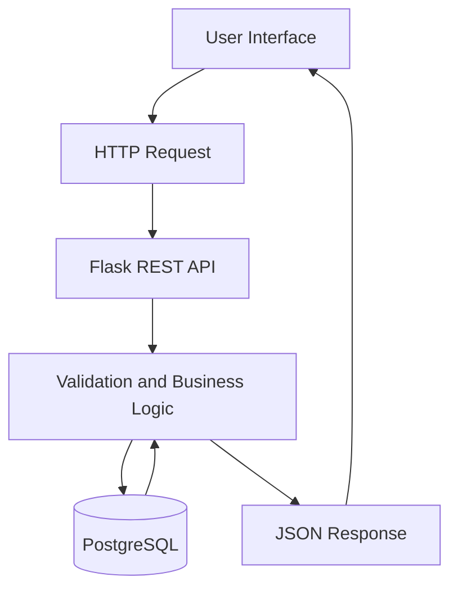
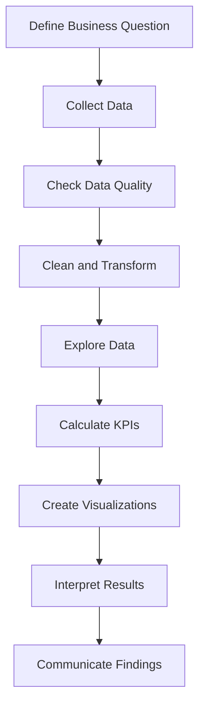

<!-- =====================================================
     KANISHKA | GITHUB PROFILE README
     Replace YOUR_GITHUB_USERNAME with your real username.
====================================================== -->

<div align="center">


<br/>


<br/><br/>

<a href="https://github.com/YOUR_GITHUB_USERNAME">

</a>
<a href="https://www.linkedin.com/">

</a>
<a href="mailto:YOUR_EMAIL">

</a>

<br/><br/>


<br/>

### ✨ Learn • Build • Analyse • Improve ✨

</div>

---

<div align="center">

# 👩‍💻 ABOUT ME

### Turning Ideas Into Practical Technology Solutions

</div>

Hi! I'm **Kanishka**, an aspiring technology professional exploring Python development, SQL, database management, data analytics, and business intelligence.

I enjoy understanding how applications work, how data moves between systems, and how structured information can be transformed into useful insights.

My learning approach combines programming fundamentals, hands-on projects, debugging, and continuous improvement.

<table>
<tr>
<td width="50%" valign="top">

### 🎯 What I Focus On

- Python programming and problem-solving.
- SQL and relational databases.
- Flask and REST API development.
- Frontend and backend integration.
- Data analysis and reporting.
- Business intelligence and visualization.

</td>
<td width="50%" valign="top">

### 🚀 My Goals

- Build practical, well-documented projects.
- Improve code quality and debugging skills.
- Create reliable database-driven applications.
- Develop analytical thinking.
- Strengthen my technical portfolio.
- Prepare for data and software-related opportunities.

</td>
</tr>
</table>

---

<div align="center">

# 💎 TECHNICAL SKILLS

*My current learning areas and technology stack*

</div>

## 🐍 Programming Languages

<div align="center">


<br/><br/>


</div>

## 🗄️ Database Technologies

<div align="center">


<br/><br/>


</div>

## 🔌 Backend and API Development

<div align="center">


<br/><br/>


</div>

## 📊 Data Analytics and Business Intelligence

<div align="center">


</div>

## ⚙️ Developer Tools and Platforms

<div align="center">


<br/><br/>


</div>

> **Note:** These badges represent the technologies included in this portfolio. Keep only the technologies you have used or are actively learning. A badge is not proof of proficiency.

---

## 📈 TECHNICAL SKILL PROGRESS

The following progress bars are examples. Adjust the percentages to reflect your actual skill level.

<div align="center">

### Programming

**Python**


**SQL**


**JavaScript**


### Backend Development

**Flask and REST APIs**


**PostgreSQL**


### Data Analytics

**Power BI**


**Pandas and NumPy**


### Tools

**Git and GitHub**


</div>

---

# 🧠 SKILLS I AM DEVELOPING

<details>
<summary><b>🐍 Python Programming</b></summary>

- Variables, data types, operators, and conditions.
- Loops, functions, and reusable code.
- Lists, tuples, dictionaries, and sets.
- File handling and exception handling.
- Object-oriented programming.
- Modules and packages.
- Debugging and code organization.

</details>

<details>
<summary><b>🗄️ SQL and Database Management</b></summary>

- SELECT, INSERT, UPDATE, and DELETE.
- Filtering, sorting, and aggregation.
- GROUP BY and HAVING.
- INNER JOIN and LEFT JOIN.
- Subqueries and common table expressions.
- Primary keys, foreign keys, and constraints.
- Database relationships and data integrity.
- Connecting Python applications to PostgreSQL.

</details>

<details>
<summary><b>🔌 Flask and REST APIs</b></summary>

- Flask routes and application structure.
- GET, POST, PUT, PATCH, and DELETE.
- JSON request and response handling.
- HTTP status codes.
- Input validation and error handling.
- Database-connected CRUD operations.
- API testing with Postman.
- Frontend and backend integration.

</details>

<details>
<summary><b>📊 Data Analytics</b></summary>

- Data inspection and quality checks.
- Missing-value and duplicate handling.
- Data cleaning and transformation.
- Exploratory data analysis.
- SQL reporting and aggregations.
- KPI calculations.
- Trend and category comparisons.
- Dashboard design and visualization.
- Communicating analytical findings.

</details>

<details>
<summary><b>⚙️ Tools and Engineering</b></summary>

- Git commits, branches, and repositories.
- GitHub project documentation.
- Docker fundamentals.
- Linux command-line basics.
- Workflow orchestration fundamentals.
- Testing and debugging.
- Environment configuration.
- Project deployment fundamentals.

</details>

---

# 🚀 FEATURED PROJECTS

<div align="center">

### Building Practical Solutions With Code and Data

</div>

<table>
<tr>
<td width="50%" valign="top">

## 🔎 AI Business Detective


**Goal:** Analyse business performance and identify useful patterns.

**Planned features**
- Revenue and sales analysis.
- KPI tracking.
- Product performance comparisons.
- Customer analysis.
- Business dashboards.
- AI-assisted insights as a possible extension.

**Technologies:** Python, SQL, PostgreSQL, Power BI.

[View Repository](https://github.com/YOUR_GITHUB_USERNAME/ai-business-detective)

</td>
<td width="50%" valign="top">

## 👥 Customer Management API


**Goal:** Manage customer records through a REST API.

**Core features**
- Create customer records.
- Retrieve customer details.
- Update customer information.
- Delete customer records.
- Validate input.
- Return JSON responses.
- Handle errors and missing records.

**Technologies:** Python, Flask, PostgreSQL, SQL.

[View Repository](https://github.com/YOUR_GITHUB_USERNAME/customer-management-api)

</td>
</tr>
<tr>
<td width="50%" valign="top">

## 🌐 Frontend and Backend Integration


**Goal:** Connect a web interface with backend services.

**Core features**
- Display API data in tables.
- Submit forms to create records.
- Update and delete records.
- Handle server responses.
- Show validation messages.
- Refresh data after changes.

**Technologies:** HTML, CSS, JavaScript, Flask, REST APIs.

[View Repository](https://github.com/YOUR_GITHUB_USERNAME/frontend-backend-integration)

</td>
<td width="50%" valign="top">

## 📈 Business Data Analysis


**Goal:** Turn structured data into understandable business findings.

**Potential analysis**
- Revenue by month.
- Sales by category.
- Customer distribution.
- Order performance.
- Growth calculations.
- Visual reporting.
- Evidence-based recommendations.

**Technologies:** Python, SQL, Pandas, Power BI.

[View Repository](https://github.com/YOUR_GITHUB_USERNAME/business-data-analysis)

</td>
</tr>
</table>

> Replace these sample repository links with your real repositories. Mark features as completed only after implementing them.

---

# 🏗️ HOW I APPROACH APPLICATION DEVELOPMENT

<div align="center">



</div>

| Component | Responsibility |
|---|---|
| HTML and CSS | Build and style the interface |
| JavaScript | Send requests and update page content |
| Flask | Process API requests |
| Business logic | Validate input and apply rules |
| PostgreSQL | Store and retrieve records |
| Python and SQL | Analyse structured information |
| Power BI | Present metrics and trends visually |

---

# 📊 DATA ANALYTICS WORKFLOW

<div align="center">



</div>

### My Analytical Focus

| Area | Activities |
|---|---|
| Data preparation | Inspect, clean, validate, and transform data |
| SQL analysis | Filter, join, aggregate, and summarize records |
| Exploratory analysis | Find patterns, trends, and unusual values |
| KPI reporting | Calculate and compare business metrics |
| Visualization | Present information using appropriate charts |
| Communication | Explain findings, assumptions, and limitations |

---

# 📚 LEARNING ROADMAP

<div align="center">


</div>

### 🐍 Python

- [ ] Strengthen programming fundamentals.
- [ ] Practise object-oriented programming.
- [ ] Write reusable functions and modules.
- [ ] Improve error handling and testing.

### 🗄️ SQL and Databases

- [ ] Practise complex joins and subqueries.
- [ ] Learn common table expressions.
- [ ] Improve database design.
- [ ] Explore indexes and query optimization.

### 🔌 Backend Development

- [ ] Build structured Flask applications.
- [ ] Improve REST API design.
- [ ] Add robust validation and error handling.
- [ ] Test API endpoints systematically.

### 📊 Data Analytics

- [ ] Practise Pandas data cleaning.
- [ ] Develop exploratory analysis projects.
- [ ] Strengthen SQL reporting.
- [ ] Build interactive Power BI dashboards.

### ⚙️ Engineering

- [ ] Improve Git collaboration workflows.
- [ ] Practise Docker fundamentals.
- [ ] Learn automated testing.
- [ ] Explore data pipeline orchestration.
- [ ] Improve project documentation and deployment.

---

# 📊 GITHUB ANALYTICS

<div align="center">

### 💻 My GitHub Statistics


<br/><br/>

### 🔥 Contribution Streak


<br/><br/>

### 📅 Contribution Activity


</div>

> **Important:** Replace every occurrence of `YOUR_GITHUB_USERNAME` with your actual username. Analytics cards depend on external services and may occasionally be unavailable. Repository language statistics do not measure proficiency.

---

# 🐍 GITHUB CONTRIBUTION SNAKE

<div align="center">


</div>

To activate this animation, create `.github/workflows/snake.yml` inside your profile repository.

```yaml
name: Generate Contribution Snake

on:
  schedule:
    - cron: "0 0 * * *"
  workflow_dispatch:

permissions:
  contents: write

jobs:
  generate:
    runs-on: ubuntu-latest
    steps:
      - name: Generate snake
        uses: Platane/snk/svg-only@v3
        with:
          github_user_name: YOUR_GITHUB_USERNAME
          outputs: dist/github-contribution-snake.svg

      - name: Publish snake
        uses: peaceiris/actions-gh-pages@v4
        with:
          publish_branch: output
          publish_dir: dist
          github_token: ${{ secrets.GITHUB_TOKEN }}
```

**Setup steps**

1. Replace `YOUR_GITHUB_USERNAME` in the workflow.
2. Commit and push `.github/workflows/snake.yml`.
3. Open the repository's **Actions** tab.
4. Run **Generate Contribution Snake**.
5. Wait for a successful run and verify the `output` branch.
6. Reload your profile README.

The snake image will not work until the workflow successfully publishes the SVG.

---

# 🏅 CERTIFICATIONS AND ACHIEVEMENTS

<details>
<summary><b>🎓 Certifications</b></summary>

Add certifications you have actually earned.

- **Certification:** Your certification name
- **Issuing organization:** Your issuer
- **Completion date:** Your date
- **Credential link:** Your verification URL

Remove this section's sample fields if you do not have certifications to list.

</details>

<details>
<summary><b>📘 Courses and Training</b></summary>

- **Course:** Your completed course
- **Platform:** Your learning platform
- **Skills gained:** Your actual learning outcomes

</details>

<details>
<summary><b>🏆 Project Achievements</b></summary>

Document verifiable results, such as:

- Completing a working CRUD API.
- Building a dashboard with validated calculations.
- Testing API endpoints.
- Publishing a reproducible analysis.
- Deploying an application.
- Improving query performance with measured evidence.

</details>

---

# 🧠 MY PROBLEM-SOLVING MINDSET

<div align="center">


<br/><br/>
⬇
<br/><br/>

<br/><br/>
⬇
<br/><br/>

<br/><br/>
⬇
<br/><br/>

<br/><br/>
⬇
<br/><br/>


</div>

### Principles I Value

- Clean, readable, and maintainable code.
- Reliable data and accurate calculations.
- Proper validation and error handling.
- Meaningful API responses.
- Reproducible analysis.
- Clear documentation.
- Evidence-based recommendations.
- Continuous learning.

---

# 🌱 WHAT I'M EXPLORING NEXT

- Advanced Python programming.
- SQL optimization and database modeling.
- Robust API design and testing.
- Data cleaning and exploratory analysis.
- Interactive business intelligence dashboards.
- Docker and application deployment.
- Data pipeline automation.
- Workflow orchestration with Apache Airflow.
- Secure application development.
- AI-assisted analytical workflows.

---

# 🤝 LET'S CONNECT

<div align="center">

### Open to Learning, Building, and Collaborating

I'm interested in connecting with people working in Python development, data analytics, databases, APIs, and business intelligence.

<a href="https://github.com/YOUR_GITHUB_USERNAME">

</a>
<a href="https://www.linkedin.com/">

</a>
<a href="mailto:YOUR_EMAIL">

</a>

<br/><br/>

### 💡 MY DEVELOPER PHILOSOPHY

# Learn Something. Build Something. Improve Something.

*Every project is an opportunity to understand a problem better and create a more useful solution.*

<br/>


</div>
