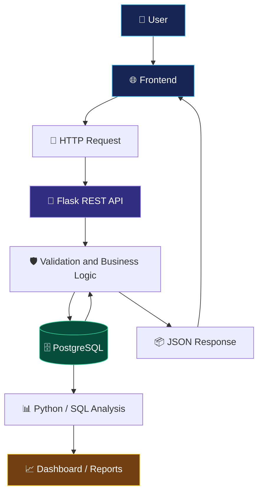

<!-- =========================================================
     NEON ANIME GITHUB PROFILE README
     Replace YOUR_USERNAME, YOUR_EMAIL and YOUR_LINKEDIN.
     ========================================================= -->

<div align="center">


<br/>


<br/><br/>

<a href="https://github.com/YOUR_USERNAME">

</a>
<a href="https://www.linkedin.com/in/YOUR_LINKEDIN_USERNAME/">

</a>
<a href="mailto:YOUR_EMAIL">

</a>

</div>

---

<h2 align="center">🌌 ABOUT ME</h2>


Hello! I'm **Kanishka**, an aspiring technology professional interested in data analytics, Python development, databases, and business intelligence.

I enjoy exploring how applications work, connecting frontend interfaces to backend APIs, managing structured data, and discovering insights that help businesses make better decisions.

- 🐍 Learning Python and object-oriented programming.
- 📊 Exploring data analysis and business intelligence.
- 🗄️ Practising SQL and PostgreSQL.
- 🔌 Building REST APIs using Flask.
- 🌐 Connecting frontend applications with backend services.
- 📈 Exploring KPIs, reporting, and dashboard design.
- ⚙️ Learning development tools and workflow automation.
- 🚀 Building projects to strengthen practical skills.

<br clear="right"/>

> 💡 **My motto:** Understand the problem, build the solution, test the result, and keep improving.

---

<h2 align="center">🎯 MY CAREER INTERESTS</h2>

<table>
<tr>
<td width="50%" valign="top">

### 📊 Data Analytics

- Data cleaning and transformation
- Exploratory data analysis
- SQL-based reporting
- KPI calculations
- Trend and performance analysis
- Data visualization
- Business insights

</td>
<td width="50%" valign="top">

### 🐍 Python Development

- Python fundamentals
- Functions and modules
- Object-oriented programming
- Flask applications
- REST API development
- Error handling
- Application debugging

</td>
</tr>
<tr>
<td width="50%" valign="top">

### 🗄️ Database Management

- SQL queries
- PostgreSQL
- CRUD operations
- Joins and subqueries
- Relational database concepts
- Data validation
- Database integration

</td>
<td width="50%" valign="top">

### 📈 Business Intelligence

- Power BI dashboards
- Business performance reports
- KPI monitoring
- Category comparisons
- Trend analysis
- Data storytelling
- Decision-support reporting

</td>
</tr>
</table>

---

<h2 align="center">🛠️ TECHNICAL SKILLS</h2>

<h3>💻 Programming Languages</h3>

<p>


</p>

<h3>🌐 Frontend Technologies</h3>

<p>


</p>

<h3>🔌 Backend and API Development</h3>

<p>


</p>

<h3>🗄️ Databases</h3>

<p>


</p>

<h3>📊 Data Analytics and Visualization</h3>

<p>


</p>

<h3>⚙️ Tools and Platforms</h3>

<p>


</p>

---

<h2 align="center">📊 TECHNICAL SKILL GRAPH</h2>

<p align="center">
These are example self-assessment values. Change them to reflect your actual experience.
</p>

<table>
<tr>
<td width="50%" valign="top">

### 🐍 Programming

**Python — 60%**


**SQL — 55%**


**JavaScript — 35%**


</td>
<td width="50%" valign="top">

### 🔌 Backend

**Flask / REST APIs — 50%**


**PostgreSQL — 50%**


**HTML / CSS — 45%**


</td>
</tr>
<tr>
<td width="50%" valign="top">

### 📈 Data Analytics

**Power BI — 40%**


**Pandas / NumPy — 35%**


</td>
<td width="50%" valign="top">

### ⚙️ Development Tools

**Git / GitHub — 50%**


**Docker / Airflow — 25%**


</td>
</tr>
</table>

---

<h2 align="center">🚀 FEATURED PROJECTS</h2>

<table>
<tr>
<td width="50%" valign="top">

<h3>🔎 AI Business Detective</h3>


**Objective:** Analyse business performance and turn data into actionable insights.

**Features to implement**
- Revenue and sales analysis
- Product performance
- Customer segmentation
- KPI monitoring
- Trend analysis
- Interactive dashboards
- AI-assisted explanations

**Stack:** Python, SQL, Power BI.

<a href="https://github.com/YOUR_USERNAME/ai-business-detective">View project</a>

</td>
<td width="50%" valign="top">

<h3>👥 Customer Management API</h3>


**Objective:** Create and manage customer records through a database-backed API.

**Features**
- Create customers
- Retrieve customer details
- Update records
- Delete records
- JSON request and response handling
- Input validation
- Error handling

**Stack:** Python, Flask, PostgreSQL.

<a href="https://github.com/YOUR_USERNAME/customer-management-api">View project</a>

</td>
</tr>
<tr>
<td width="50%" valign="top">

<h3>🌐 Frontend + Backend Integration</h3>


**Objective:** Connect a user interface to backend API endpoints.

**Features**
- Dynamic data tables
- Form submissions
- CRUD operations
- API response handling
- Validation messages
- Responsive design
- Error feedback

**Stack:** HTML, CSS, JavaScript, Flask.

<a href="https://github.com/YOUR_USERNAME/frontend-backend-integration">View project</a>

</td>
<td width="50%" valign="top">

<h3>📈 Business Data Analysis</h3>


**Objective:** Analyse business datasets to identify trends and performance patterns.

**Features**
- Data cleaning
- Exploratory analysis
- SQL reports
- KPI calculations
- Category comparisons
- Trend analysis
- Data visualization

**Stack:** Python, SQL, Pandas, Power BI.

<a href="https://github.com/YOUR_USERNAME/business-data-analysis">View project</a>

</td>
</tr>
</table>

> ⚠️ These are suggested project cards. Create the repositories and implement the described features before presenting them as completed projects.

---

<h2 align="center">🏗️ APPLICATION ARCHITECTURE</h2>



---

<h2 align="center">📚 MY LEARNING ROADMAP</h2>

<table>
<tr>
<td width="50%" valign="top">

### 🐍 Python
- [ ] Strengthen Python fundamentals
- [ ] Practise functions and modules
- [ ] Improve OOP knowledge
- [ ] Learn exception handling
- [ ] Practise automated testing

### 🗄️ SQL
- [ ] Practise joins and subqueries
- [ ] Learn common table expressions
- [ ] Improve database design
- [ ] Understand indexes and transactions
- [ ] Write analytical queries

</td>
<td width="50%" valign="top">

### 📊 Data Analytics
- [ ] Practise data cleaning
- [ ] Learn exploratory data analysis
- [ ] Build SQL reports
- [ ] Create Power BI dashboards
- [ ] Improve KPI storytelling

### ⚙️ Engineering Tools
- [ ] Improve Git workflows
- [ ] Learn Docker fundamentals
- [ ] Explore workflow orchestration
- [ ] Write project documentation
- [ ] Practise deployment

</td>
</tr>
</table>

---

<h2 align="center">📊 GITHUB ANALYTICS</h2>

<div align="center">

<a href="https://github.com/YOUR_USERNAME">

</a>
<a href="https://github.com/YOUR_USERNAME">

</a>

<br/><br/>


<br/><br/>


</div>

> 📌 These cards rely on external services. If one fails, check the username and try again later. Language statistics reflect repository code, not your overall skill level.

---

<h2 align="center">🐍 CONTRIBUTION SNAKE</h2>

<div align="center">


</div>

### ⚡ Enable the Snake Animation

Create `.github/workflows/snake.yml` in your GitHub profile repository:

```yaml
name: Generate Contribution Snake

on:
  schedule:
    - cron: "0 0 * * *"
  workflow_dispatch:

permissions:
  contents: write

jobs:
  generate:
    runs-on: ubuntu-latest
    steps:
      - name: Generate snake
        uses: Platane/snk/svg-only@v3
        with:
          github_user_name: YOUR_USERNAME
          outputs: dist/github-contribution-snake.svg

      - name: Publish snake
        uses: peaceiris/actions-gh-pages@v4
        with:
          publish_branch: output
          publish_dir: dist
          github_token: ${{ secrets.GITHUB_TOKEN }}
```

**Setup checklist**
1. Replace `YOUR_USERNAME` with your actual username.
2. Commit and push the workflow file.
3. Open the repository's **Actions** tab.
4. Run **Generate Contribution Snake**.
5. Confirm that the workflow succeeds and publishes the `output` branch.
6. Refresh your profile after the SVG is available.

---

<h2 align="center">🏆 CERTIFICATIONS & ACHIEVEMENTS</h2>

<details>
<summary>🎓 Certifications</summary>

Add certifications you have actually earned.

- **Certification:** YOUR_CERTIFICATION
- **Issuer:** YOUR_ISSUER
- **Completion date:** YOUR_COMPLETION_DATE
- **Credential:** YOUR_CREDENTIAL_URL

</details>

<details>
<summary>📘 Courses and Training</summary>

- **Course:** YOUR_COMPLETED_COURSE
- **Platform:** YOUR_LEARNING_PLATFORM
- **Skills gained:** YOUR_LEARNED_SKILLS

</details>

<details>
<summary>🏅 Project Achievements</summary>

Add achievements supported by your actual work, for example:

- Developed a database-backed REST API.
- Implemented CRUD operations and input validation.
- Built a dashboard with tested KPI calculations.
- Published a reproducible data analysis.
- Documented project installation and usage.

</details>

---

<h2 align="center">🧠 MY DEVELOPER MINDSET</h2>

<table>
<tr>
<td align="center" width="25%">

### 🔍
**Understand**

Find the real problem.

</td>
<td align="center" width="25%">

### 🛠️
**Build**

Turn ideas into solutions.

</td>
<td align="center" width="25%">

### 🧪
**Test**

Check results and errors.

</td>
<td align="center" width="25%">

### 🚀
**Improve**

Learn and iterate.

</td>
</tr>
</table>

<div align="center">

### ⚡ Think Clearly. Code Carefully. Grow Consistently.


</div>

---

<h2 align="center">🤝 LET'S CONNECT</h2>

<div align="center">

I'm interested in learning, collaborating on practical projects, and exploring opportunities in data analytics and software development.

<a href="https://github.com/YOUR_USERNAME">

</a>
<a href="https://www.linkedin.com/in/YOUR_LINKEDIN_USERNAME/">

</a>
<a href="mailto:YOUR_EMAIL">

</a>

<br/><br/>

### 💜 DREAM BIG • BUILD SMART • LEVEL UP


</div>
