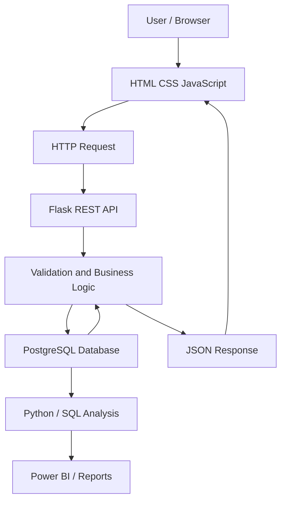
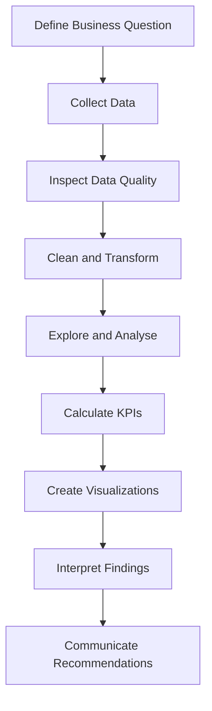

<!-- =========================================================
     KANISHKA | GITHUB PROFILE PORTFOLIO
     Replace YOUR_USERNAME and other placeholders.
========================================================== -->

 

  

---

# 👩‍💻 ABOUT ME

### Turning Curiosity Into Practical Solutions

Hello! I'm **Kanishka**, an aspiring technology professional interested in Python development, data analytics, database management, and business intelligence.

I enjoy exploring how applications work, how data flows between systems, how databases organize information, and how analytical insights can support better decisions.

My approach is to learn concepts, apply them through hands-on projects, investigate errors, and improve my implementation step by step.

<b>🔍 More About Me</b>

 

- 🐍 Exploring Python programming and application development.
- 🗄️ Practising SQL queries and relational database concepts.
- 🔌 Building familiarity with Flask and REST API development.
- 🌐 Learning to connect frontend interfaces with backend services.
- 📊 Exploring business data analysis and KPI reporting.
- 📈 Interested in dashboard design and data visualization.
- 🧩 Enjoy solving problems by breaking them into manageable steps.
- 🚀 Building projects to strengthen practical technical skills.
- 🎯 Working toward a strong, well-documented technical portfolio.

---

# 🎯 MY CAREER FOCUS

<table>
<tr>
<td width="50%" valign="top">

### 📊 Data Analytics

Understand datasets, investigate patterns, calculate metrics, compare performance, and communicate findings clearly.

**Focus:** SQL, Python, data cleaning, visualization, Power BI.

</td>
<td width="50%" valign="top">

### 🐍 Python Development

Build reusable programs, implement application logic, automate tasks, and develop backend services.

**Focus:** Python, Flask, debugging, APIs, application structure.

</td>
</tr>
<tr>
<td width="50%" valign="top">

### 🗄️ Database Management

Store and retrieve structured records, maintain relationships, and build reliable database-driven applications.

**Focus:** PostgreSQL, SQL, CRUD, data integrity.

</td>
<td width="50%" valign="top">

### 🌐 Application Integration

Connect interfaces to backend endpoints, process responses, and present data dynamically.

**Focus:** HTML, CSS, JavaScript, JSON, HTTP.

</td>
</tr>
</table>

---

# 💻 TECHNICAL SKILLS

## 📈 Skill Progress Dashboard

The percentages below are **editable self-assessment examples**, not measured test results. Adjust them to reflect your real abilities.

<table>
<tr>
<td width="50%" valign="top">

### 🐍 Programming

**Python**

**SQL**

**JavaScript**

</td>
<td width="50%" valign="top">

### 🗄️ Backend and Databases

**Flask / REST APIs**

**PostgreSQL**

**HTML / CSS**

</td>
</tr>
<tr>
<td width="50%" valign="top">

### 📊 Data and Visualization

**Power BI**

**Pandas / NumPy**

</td>
<td width="50%" valign="top">

### ⚙️ Development Tools

**Git / GitHub**

**Docker / Airflow**

</td>
</tr>
</table>

> Progress bars are visual self-assessments, not objective proficiency measurements. If a progress-bar service is unavailable, replace these with Markdown bars such as `Python: ██████░░░░ 60%`.

## 🧩 Skills by Category

<b>🐍 Programming and Software Fundamentals</b>

- Variables, data types, operators, and expressions.
- Conditions, loops, and control flow.
- Functions, modules, and reusable code.
- Lists, tuples, dictionaries, and sets.
- Exception handling and debugging.
- Object-oriented programming concepts.
- File handling and basic automation.
- Code readability and organization.

<b>🗄️ SQL and Database Management</b>

- SELECT, INSERT, UPDATE, and DELETE.
- WHERE, ORDER BY, and GROUP BY.
- Aggregate functions.
- INNER JOIN, LEFT JOIN, and other joins.
- Subqueries and common table expressions.
- Primary keys and foreign keys.
- Constraints and relational data modeling.
- Connecting Python applications to PostgreSQL.
- Database validation and CRUD workflows.

<b>🔌 Backend and API Development</b>

- Flask application structure and routing.
- GET, POST, PUT, PATCH, and DELETE.
- REST endpoint design.
- JSON request and response handling.
- HTTP status codes.
- Input validation.
- Error handling and logging.
- Database integration.
- API testing and documentation.

<b>🌐 Frontend Development</b>

- HTML page structure.
- CSS styling and layout.
- Responsive interface fundamentals.
- JavaScript event handling.
- Fetch API and asynchronous requests.
- Form validation.
- Dynamic tables and data rendering.
- Success and failure messages.
- Frontend/backend communication.

<b>📊 Data Analytics and Business Intelligence</b>

- Dataset inspection and profiling.
- Missing-value and duplicate checks.
- Data cleaning and transformation.
- Exploratory data analysis.
- SQL-based business reporting.
- KPI definition and calculation.
- Trend and category comparisons.
- Charts and data visualization.
- Dashboard planning and reporting.
- Evidence-based interpretation of results.

---

# 🧰 TECHNOLOGY STACK

### Programming Languages

### Backend and Databases

### Data and Analytics

### Tools and Platforms

> Technology icons indicate areas included in this portfolio, not necessarily professional mastery. Remove technologies you have not used or started learning.

---

# 🚀 FEATURED PROJECTS

### Practical Projects • Real Problems • Continuous Improvement

<table>
<tr>
<td width="50%" valign="top">

## 🔎 AI Business Detective

**Objective:** Explore business performance and convert structured data into useful insights.

**Potential capabilities:**
- KPI monitoring.
- Revenue and sales analysis.
- Product performance comparisons.
- Customer segmentation.
- Trend identification.
- Interactive dashboards.
- AI-assisted explanations as a future enhancement.

**Proposed stack:** Python, SQL, PostgreSQL, Power BI.

[Explore Project](https://github.com/YOUR_USERNAME/ai-business-detective)

</td>
<td width="50%" valign="top">

## 👥 Customer Management API

**Objective:** Practise managing customer records through a REST API and database.

**Core capabilities:**
- Create customer records.
- Retrieve individual or multiple records.
- Update existing information.
- Delete records.
- Validate requests.
- Return JSON responses.
- Handle missing records and invalid input.

**Proposed stack:** Python, Flask, PostgreSQL, SQL.

[Explore Project](https://github.com/YOUR_USERNAME/customer-management-api)

</td>
</tr>
<tr>
<td width="50%" valign="top">

## 🌐 Frontend + Backend Integration

**Objective:** Connect a browser interface to backend endpoints.

**Core capabilities:**
- Display API data in tables.
- Submit forms to create records.
- Edit and delete records.
- Handle API responses.
- Show validation and error messages.
- Update the page after operations.

**Proposed stack:** HTML, CSS, JavaScript, Flask, REST APIs.

[Explore Project](https://github.com/YOUR_USERNAME/frontend-backend-integration)

</td>
<td width="50%" valign="top">

## 📈 Business Data Analysis

**Objective:** Investigate business datasets and communicate findings.

**Potential analysis:**
- Revenue by month.
- Product category comparisons.
- Customer distribution.
- Order and sales metrics.
- Growth calculations.
- Visual reporting.
- Business recommendations.

**Proposed stack:** Python, SQL, Pandas, Power BI.

[Explore Project](https://github.com/YOUR_USERNAME/business-data-analysis)

</td>
</tr>
</table>

> The project cards describe intended scope. Replace the links with your real repositories and distinguish implemented features from planned ones.

---

# 🏗️ APPLICATION ARCHITECTURE

### How the Components Work Together

| Component | Responsibility |
|---|---|
| User interface | Collect input and display information |
| JavaScript | Send requests and update page content |
| Flask API | Receive requests and return responses |
| Application logic | Validate data and apply rules |
| PostgreSQL | Store and retrieve structured records |
| Python / SQL analysis | Transform data and calculate metrics |
| Power BI / reporting | Present data visually |

---

# 📊 DATA ANALYTICS WORKFLOW

### Analytical Activities

**Data preparation**
- Inspect columns, types, and missing values.
- Identify duplicate or inconsistent records.
- Apply suitable transformations.
- Validate important assumptions.

**Data analysis**
- Calculate totals, averages, and percentages.
- Group data by time, category, or customer.
- Compare periods and performance segments.
- Identify unusual changes that need investigation.

**Reporting**
- Choose suitable visualizations.
- Present KPIs with clear definitions.
- Explain what the findings mean.
- State assumptions and limitations.

---

# 📚 MY LEARNING ROADMAP

### 🐍 Python Development

- [ ] Strengthen programming fundamentals.
- [ ] Practise functions, modules, and OOP.
- [ ] Improve exception handling.
- [ ] Write reusable code.
- [ ] Practise unit testing.

### 🗄️ SQL and Databases

- [ ] Practise joins and subqueries.
- [ ] Learn common table expressions.
- [ ] Improve database design.
- [ ] Understand transactions and indexes.
- [ ] Practise complex analytical queries.

### 🔌 Backend Development

- [ ] Build structured Flask applications.
- [ ] Implement REST API conventions.
- [ ] Improve validation and error handling.
- [ ] Test endpoints systematically.
- [ ] Explore authentication and deployment.

### 📊 Data Analytics

- [ ] Practise data cleaning with Pandas.
- [ ] Develop exploratory data analysis skills.
- [ ] Strengthen SQL reporting.
- [ ] Build Power BI dashboards.
- [ ] Improve KPI design and communication.

### ⚙️ Engineering Tools

- [ ] Improve Git branching and collaboration.
- [ ] Learn Docker fundamentals.
- [ ] Explore automated testing.
- [ ] Understand workflow orchestration.
- [ ] Improve documentation and project deployment.

---

# 📊 GITHUB ANALYTICS

### 🔥 Contribution Streak

---

Replace `YOUR_USERNAME`, commit the file, and run the workflow from the **Actions** tab. The snake image will appear only after the workflow successfully publishes the SVG to the `output` branch.

---

# 🏅 CERTIFICATIONS AND ACHIEVEMENTS

<b>🎓 Certifications</b>

Add qualifications you have actually earned.

- **Certification:** YOUR_CERTIFICATION
- **Issuer:** YOUR_ISSUER
- **Date:** YOUR_COMPLETION_DATE
- **Credential:** YOUR_CREDENTIAL_URL

<b>📜 Courses and Training</b>

- **Course:** YOUR_COMPLETED_COURSE
- **Platform:** YOUR_LEARNING_PLATFORM
- **Skills acquired:** YOUR_LEARNED_SKILLS

<b>🏆 Project Achievements</b>

Document verifiable results, such as:

- Completing and documenting a working API.
- Building a dashboard with validated calculations.
- Writing tests for API endpoints.
- Publishing a reproducible data analysis.
- Deploying a project that others can access.

---

# 🧠 MY PROBLEM-SOLVING APPROACH

| Step | Approach |
|---|---|
| 🔍 01 | Understand the problem |
| 🧩 02 | Break it into smaller tasks |
| 🔎 03 | Investigate the available information |
| 🛠️ 04 | Design and implement a solution |
| 🧪 05 | Test expected and unexpected cases |
| 📝 06 | Document the result |
| 🚀 07 | Improve through feedback |

### Principles I Value

- Readable, maintainable code.
- Accurate calculations and reliable data.
- Consistent database operations.
- Clear API responses and meaningful errors.
- Practical, testable implementations.
- Documentation that helps other developers.
- Evidence-based analysis.
- Continuous learning and improvement.

---

# 🌱 WHAT I'M EXPLORING NEXT

- Advanced Python and software design.
- SQL query optimization and database modeling.
- Robust API design and testing.
- Data cleaning and exploratory analysis.
- Interactive business intelligence dashboards.
- Docker and deployment fundamentals.
- Workflow orchestration and data pipelines.
- Secure application design.
- AI-assisted analytical workflows.

---

# 🤝 LET'S CONNECT

I'm interested in learning, collaborating, and sharing knowledge around Python, data analytics, databases, APIs, and business intelligence.

  

### 💡 MY DEVELOPER PHILOSOPHY

**Understand → Analyse → Build → Test → Improve**

*Every project is an opportunity to learn something new and build something better.*

