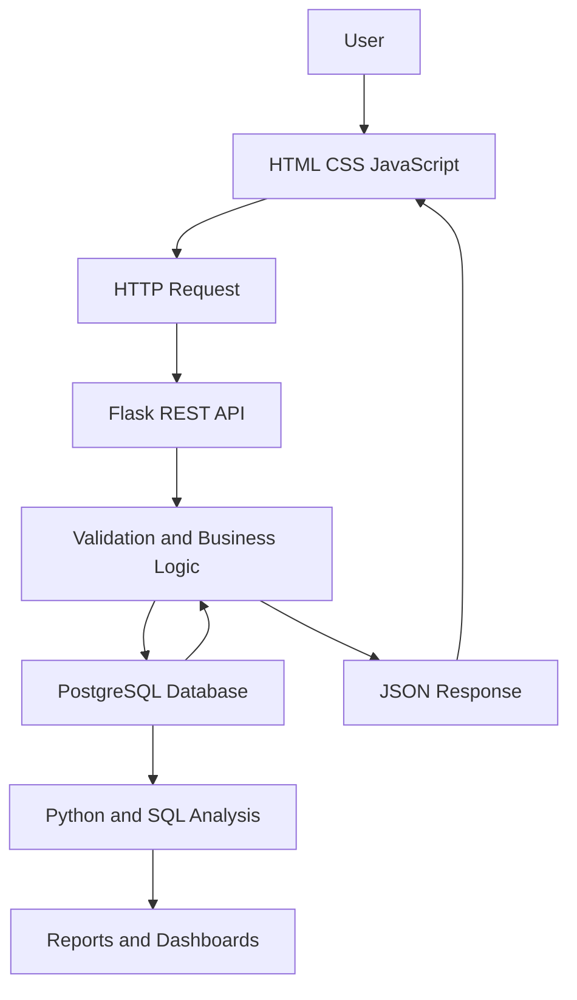
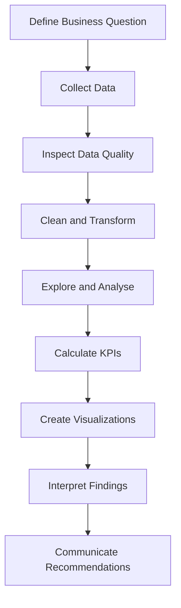

<!-- =====================================================
     KANISHKA | GITHUB PROFILE README
     Replace YOUR_GITHUB_USERNAME and contact placeholders.
====================================================== -->

<div align="center">


<br/><br/>

<a href="https://github.com/YOUR_GITHUB_USERNAME">

</a>
<a href="https://www.linkedin.com/in/YOUR_LINKEDIN_USERNAME/">

</a>
<a href="mailto:YOUR_EMAIL">

</a>

<br/><br/>


</div>

---

# 👩‍💻 ABOUT ME


Hello! I'm **Kanishka**, an aspiring technology professional interested in Python programming, data analytics, database management, and business intelligence.

I enjoy understanding how applications work, how databases manage information, and how data can be transformed into meaningful insights.

### 🎯 My Interests

- 🐍 Python programming and application development.
- 🗄️ SQL and relational database management.
- 🔌 REST API development using Flask.
- 🌐 Frontend and backend integration.
- 📊 Data analytics and business intelligence.
- 📈 Data visualization and dashboard development.
- ⚙️ Automation and workflow tools.
- 🧩 Debugging, problem-solving, and continuous learning.

<details>
<summary><b>✨ More About Me</b></summary>

<br/>

- I enjoy learning by implementing practical projects.
- I am developing my understanding of application architecture.
- I practise working with API requests, JSON responses, and database operations.
- I am interested in analyzing business information and identifying useful patterns.
- I value readable code, accurate results, and clear documentation.
- I aim to build a portfolio that demonstrates practical technical abilities.

</details>

---

# 🎯 CAREER OBJECTIVE

My objective is to strengthen my technical foundation and build practical solutions using programming, databases, and analytics.

I am particularly interested in projects that combine data processing, application development, and business problem-solving.

| Area | Goal |
|---|---|
| Programming | Write clear and reusable Python code |
| Databases | Design and query relational databases |
| Backend | Build reliable APIs and application logic |
| Analytics | Extract useful insights from structured data |
| Visualization | Present findings through dashboards and reports |
| Professional growth | Build, document, test, and improve projects |

---

# 💻 TECHNICAL SKILLS

<div align="center">


</div>

## 🐍 1. Programming Languages

<div align="left">


</div>

| Skill | What I Practise |
|---|---|
| Python | Variables, loops, functions, collections, exceptions, OOP |
| SQL | SELECT, filtering, joins, aggregation, subqueries, CRUD |
| JavaScript | Variables, functions, events, Fetch API, JSON |
| HTML | Page structure, forms, tables, semantic elements |
| CSS | Selectors, layouts, Flexbox, Grid, responsive styling |

## 🗄️ 2. Database Technologies

<div align="left">


</div>

- Relational database concepts.
- Tables, rows, columns, and data types.
- Primary keys and foreign keys.
- INSERT, SELECT, UPDATE, and DELETE.
- Filtering, sorting, and grouping.
- INNER JOIN and LEFT JOIN.
- Constraints and data validation.
- Connecting Python applications to PostgreSQL.
- Database-driven CRUD applications.

## 🔌 3. Backend and API Development

<div align="left">


</div>

- Flask application structure.
- URL routing and HTTP methods.
- REST API fundamentals.
- GET, POST, PUT, PATCH, and DELETE.
- JSON request and response handling.
- Request validation.
- HTTP status codes.
- Exception handling.
- Database integration.
- API testing and debugging.

## 🌐 4. Frontend Development

<div align="left">


</div>

- HTML page structure.
- CSS styling and responsive layouts.
- JavaScript event handling.
- Forms and input validation.
- Fetch API and asynchronous requests.
- Dynamic table rendering.
- API response handling.
- Success and error messages.
- Connecting frontend interfaces to backend APIs.

## 📊 5. Data Analytics and Business Intelligence

<div align="left">


</div>

- Data collection and inspection.
- Data cleaning and transformation.
- Missing-value and duplicate checks.
- Exploratory data analysis.
- Aggregation and KPI calculations.
- Sales and revenue analysis.
- Trend and category comparisons.
- Charts and visualization.
- Dashboard planning.
- Business reporting and insight communication.

## ⚙️ 6. Development Tools and Platforms

<div align="left">


</div>

- Git version control.
- GitHub repositories and documentation.
- VS Code development environment.
- Command-line fundamentals.
- Docker and containerization fundamentals.
- Linux and terminal basics.
- Apache Airflow and workflow orchestration concepts.

> Remove any technology or skill that you have not started learning. This section describes your learning areas, not a claim of professional expertise.

---

## 📈 TECHNICAL SKILL GRAPH

The following bars use illustrative values. Update each percentage to match your current proficiency.

### Programming and Databases

**Python — 60%**


**SQL — 55%**


**PostgreSQL — 50%**


### Backend and Frontend

**Flask and REST APIs — 50%**


**HTML and CSS — 45%**


**JavaScript — 35%**


### Analytics and Tools

**Power BI — 40%**


**Git and GitHub — 50%**


**Docker and Airflow — 25%**


> These are self-assessment examples, not test scores. Progress-bar images require an external service. If the service fails, replace the image with a plain-text progress bar such as `Python: ██████░░░░ 60%`.

---

# 🧰 TECHNOLOGY BADGES

<div align="center">

### Languages


### Web Development


### Databases and Analytics


### Tools


</div>

---

# 🚀 FEATURED PROJECTS

<div align="center">

### Practical Projects • Problem Solving • Continuous Improvement

</div>

<table>
<tr>
<td width="50%" valign="top">

## 🔎 AI Business Detective


**Objective:** Analyze business performance and communicate findings through useful metrics.

**Planned features**
- Revenue and sales analysis.
- Product and category comparisons.
- Customer performance analysis.
- KPI tracking.
- Dashboard-based reporting.
- AI-assisted insights as a future enhancement.

**Possible technologies:** Python, SQL, PostgreSQL, Power BI.

[View Repository](https://github.com/YOUR_GITHUB_USERNAME/ai-business-detective)

</td>
<td width="50%" valign="top">

## 👥 Customer Management API


**Objective:** Manage customer records through an API and relational database.

**Core features**
- Create customer records.
- Retrieve customer details.
- Update existing records.
- Delete records.
- Validate incoming requests.
- Handle missing records and errors.
- Return JSON responses.

**Possible technologies:** Python, Flask, PostgreSQL, SQL.

[View Repository](https://github.com/YOUR_GITHUB_USERNAME/customer-management-api)

</td>
</tr>
<tr>
<td width="50%" valign="top">

## 🌐 Frontend and Backend Integration


**Objective:** Connect a web interface to backend API endpoints.

**Core features**
- Display records in a table.
- Submit forms.
- Edit and delete records.
- Fetch data dynamically.
- Show success and error messages.
- Refresh the interface after operations.

**Possible technologies:** HTML, CSS, JavaScript, Flask, REST APIs.

[View Repository](https://github.com/YOUR_GITHUB_USERNAME/frontend-backend-integration)

</td>
<td width="50%" valign="top">

## 📊 Business Data Analysis


**Objective:** Analyze structured datasets to understand business performance.

**Potential analysis**
- Revenue by month.
- Sales by category.
- Customer distribution.
- Product comparisons.
- KPI calculations.
- Data visualizations.
- Evidence-based recommendations.

**Possible technologies:** Python, SQL, Pandas, Power BI.

[View Repository](https://github.com/YOUR_GITHUB_USERNAME/business-data-analysis)

</td>
</tr>
</table>

> These project descriptions are templates. Update the feature lists and links to match the actual implementation in each repository.

---

# 🏗️ APPLICATION ARCHITECTURE



| Component | Responsibility |
|---|---|
| Frontend | Collect input and display records |
| JavaScript | Send requests and update the interface |
| Flask | Handle routes and API requests |
| Business logic | Validate data and apply application rules |
| PostgreSQL | Store and retrieve structured information |
| Python and SQL | Transform data and calculate metrics |
| Dashboard | Present KPIs and analytical findings |

---

# 📊 DATA ANALYTICS WORKFLOW



### Data Analysis Checklist

- [ ] Identify the business question.
- [ ] Inspect dataset structure.
- [ ] Check missing values and duplicates.
- [ ] Clean and transform data.
- [ ] Perform exploratory analysis.
- [ ] Calculate relevant KPIs.
- [ ] Compare categories and time periods.
- [ ] Build appropriate visualizations.
- [ ] Validate calculations.
- [ ] Document findings and limitations.

---

# 📚 LEARNING ROADMAP

### 🐍 Python
- [ ] Strengthen programming fundamentals.
- [ ] Practise functions, modules, and OOP.
- [ ] Improve exception handling.
- [ ] Write reusable code.
- [ ] Learn testing fundamentals.

### 🗄️ SQL and Databases
- [ ] Practise complex joins.
- [ ] Learn subqueries and CTEs.
- [ ] Improve database design.
- [ ] Understand transactions and indexes.
- [ ] Practise analytical SQL queries.

### 🔌 Backend Development
- [ ] Build structured Flask applications.
- [ ] Improve API validation.
- [ ] Test endpoints systematically.
- [ ] Learn authentication fundamentals.
- [ ] Explore deployment.

### 📊 Data Analytics
- [ ] Practise Pandas and data cleaning.
- [ ] Perform exploratory data analysis.
- [ ] Build SQL reports.
- [ ] Develop Power BI dashboards.
- [ ] Improve KPI interpretation.

### ⚙️ Engineering Tools
- [ ] Improve Git workflows.
- [ ] Learn Docker fundamentals.
- [ ] Practise automated testing.
- [ ] Explore workflow orchestration.
- [ ] Improve deployment and documentation.

---

# 📊 GITHUB ANALYTICS

<div align="center">


<br/><br/>


<br/><br/>


</div>

**If analytics cards fail:** verify your username and try opening each image URL directly in a browser. These are third-party services, so their availability is not guaranteed.

---

# 🐍 GITHUB CONTRIBUTION SNAKE

<div align="center">


</div>

To generate the animation, create `.github/workflows/snake.yml` inside your profile repository.

```yaml
name: Generate Contribution Snake

on:
  schedule:
    - cron: "0 0 * * *"
  workflow_dispatch:

permissions:
  contents: write

jobs:
  generate:
    runs-on: ubuntu-latest

    steps:
      - name: Generate snake
        uses: Platane/snk/svg-only@v3
        with:
          github_user_name: YOUR_GITHUB_USERNAME
          outputs: dist/github-contribution-snake.svg

      - name: Publish SVG
        uses: peaceiris/actions-gh-pages@v4
        with:
          publish_branch: output
          publish_dir: dist
          github_token: ${{ secrets.GITHUB_TOKEN }}
```

**Enable it:**

1. Replace the username in the workflow.
2. Commit and push `.github/workflows/snake.yml`.
3. Open the repository's **Actions** tab.
4. Select **Generate Contribution Snake** and click **Run workflow**.
5. Confirm the workflow succeeds and creates the `output` branch.

The snake image remains unavailable until the workflow publishes the SVG successfully.

---

# 🏅 CERTIFICATIONS AND ACHIEVEMENTS

<details>
<summary><b>🎓 Certifications</b></summary>

Add only certifications you have earned.

- **Certification:** YOUR_CERTIFICATION
- **Issuer:** YOUR_ISSUER
- **Completion date:** YOUR_COMPLETION_DATE
- **Credential URL:** YOUR_CREDENTIAL_URL

</details>

<details>
<summary><b>📖 Courses and Training</b></summary>

- **Course:** YOUR_COMPLETED_COURSE
- **Platform:** YOUR_LEARNING_PLATFORM
- **Skills learned:** YOUR_LEARNED_SKILLS

</details>

<details>
<summary><b>🏆 Project Achievements</b></summary>

Document measurable, verifiable outcomes, such as:

- Implementing and testing CRUD endpoints.
- Creating a dashboard with validated KPI calculations.
- Publishing a reproducible data analysis.
- Documenting application setup and usage.
- Deploying a working application.

</details>

---

# 🧠 MY PROBLEM-SOLVING APPROACH

<div align="center">

| Stage | Action |
|---|---|
| 🔍 01 | Understand the problem |
| 🧩 02 | Break it into smaller tasks |
| 📋 03 | Plan the solution |
| 🛠️ 04 | Implement the code |
| 🧪 05 | Test and debug |
| 📝 06 | Document the result |
| 🚀 07 | Review and improve |

</div>

### Principles I Follow

- Write readable and maintainable code.
- Validate data before processing it.
- Use appropriate database operations.
- Handle errors clearly.
- Test important application behavior.
- Document setup and usage.
- Explain analytical findings with evidence.
- Improve solutions through feedback.

---

# 🌱 WHAT I'M EXPLORING NEXT

- Advanced Python programming.
- SQL optimization and database design.
- Robust REST API development.
- Data cleaning and exploratory analysis.
- Interactive Power BI dashboards.
- Docker and deployment.
- Workflow orchestration.
- Automated testing.
- Secure application development.
- AI-assisted business analysis.

---

# 🤝 LET'S CONNECT

<div align="center">

I'm interested in connecting with people working in Python development, data analytics, database management, API development, and business intelligence.

<a href="https://github.com/YOUR_GITHUB_USERNAME">

</a>
<a href="https://www.linkedin.com/in/YOUR_LINKEDIN_USERNAME/">

</a>
<a href="mailto:YOUR_EMAIL">

</a>

<br/><br/>

### 💡 MY DEVELOPER PHILOSOPHY

**Understand → Analyse → Build → Test → Improve**

*Every project is an opportunity to learn, solve problems, and build something better.*


</div>
